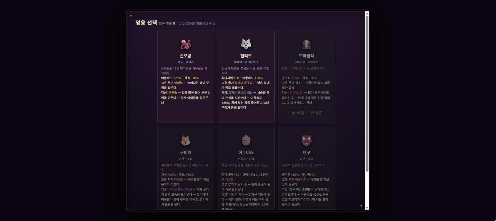
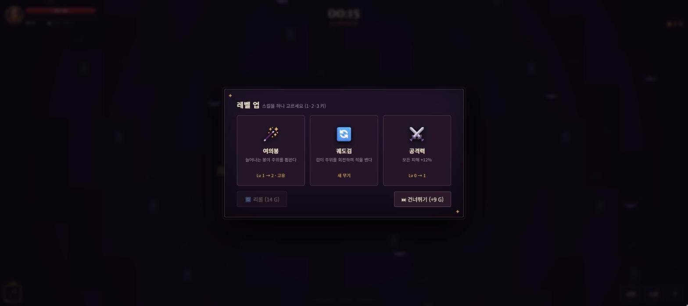

# Mythos Survivors (미토스 서바이버즈)

세계 각지 설화의 영웅 6명 중 한 명을 골라, 사방에서 몰려오는 적을 자동 공격으로 물리치며 버티는 웹 액션 게임입니다(뱀파이어 서바이버즈류). 10분에 나타나는 최종보스를 쓰러뜨리면 승리합니다.

- 바로 보기: https://develop-korea-tech.github.io/mythos_survivors/
- 형태: 단일 HTML 파일(`index.html`) · 설치 없음 · PC(키보드·마우스)와 모바일(터치) 지원
- 기술: HTML · CSS · JavaScript(Canvas 2D, Web Audio API) · 외부 라이브러리 없음 · 글꼴만 Google Fonts(Cinzel, Noto Sans KR)
- 만든 시기: 2026-09 (마지막 업로드 기준)

| 영웅 선택 — 6명, 처음에는 손오공 · 펜리르만 열림 | 레벨 업 — 스킬 3개 중 하나 선택 |
|---|---|
|  |  |

## 1. 주요 기능

- **영웅 6명**: 손오공(중국), 펜리르(북유럽), 드라큘라(루마니아), 구미호(한국), 아누비스(이집트), 텐구(일본). 영웅마다 능력치 보정과 고유 무기가 있고, 고유 무기를 각성시키면 그 영웅의 설화를 바탕으로 한 형태로 바뀝니다(예: 손오공의 여의봉 → 분신술). 처음에는 손오공·펜리르만 쓸 수 있고, 나머지 4명은 영혼으로 해금합니다.
- **자동 공격**: 플레이어는 이동만 조작합니다. 가진 무기는 각자의 쿨다운마다 자동으로 발동합니다.
- **무기 15종**: 공용 9종 + 영웅 고유 6종. 한 판에 최대 5개까지 가질 수 있고, Lv5까지 올린 뒤 조건을 채우면 Lv6 각성 형태가 됩니다.
- **패시브 9종**: 공격력 · 최대 체력 · 이동 속도 · 쿨다운 · 자석 · 투사체 · 범위 · 행운 · 흡혈, 각각 최대 Lv5.
- **스테이지 3개**: 안개의 묘지(초보) · 불타는 심연(중급) · 얼어붙은 종말(고급). 스테이지마다 일반 적 10종, 보스 6마리, 맵 특성이 다릅니다.
- **보스 일정**: 2·4·6·8분에 보스, 5분에 중간보스, 10분에 최종보스가 나옵니다. 최종보스를 처치하면 승리(VICTORY), 쓰러지면 패배(GAME OVER)입니다.
- **한 판 안의 성장**: 레벨업 카드 선택(리롤·건너뛰기 가능), 골드로 사는 상점 9종, 보스가 떨어뜨리는 보물상자.
- **영구 성장**: 판이 끝나면 영혼을 얻고, 영혼으로 영혼의 제단 강화(10종)와 영웅 해금을 합니다. 중급·고급 스테이지는 조건을 채우면 열립니다.
- **스킬 트리 화면**: 무기·패시브 레벨, 각성 조건 충족 여부, 무기별 누적 피해량과 비율을 보여 줍니다.
- **설정 5종**: 음소거, 화면 흔들림, 각성 플래시, 피해 숫자 표시, 조이스틱 고정.
- **저장**: 영혼 · 해금 상태 · 제단 레벨 · 최고 기록 · 설정을 브라우저(localStorage)에 저장합니다.
- **그래픽·소리**: 이미지·오디오 파일을 쓰지 않습니다. 캐릭터·적·효과는 모두 Canvas 2D 도형으로 그리고, 효과음은 Web Audio API로 그때그때 합성합니다. 아이콘은 이모지 문자입니다.

## 2. 조작 방법

### PC (키보드 · 마우스)

| 입력 | 동작 |
|---|---|
| `W` `A` `S` `D` 또는 방향키 | 이동 (대각선 가능) |
| (입력 없음) | 공격은 자동입니다 |
| `1` `2` `3` | 레벨업 카드 선택 (왼쪽부터) |
| 마우스 클릭 | 카드·버튼 선택 |
| `B` | 상점 열기 / 닫기 |
| `Tab` | 스킬 트리 열기 / 닫기 |
| `P` | 일시정지 / 계속 |
| `Esc` | 열린 창(상점·스킬 트리·일시정지·보물상자) 닫기. 열린 창이 없으면 일시정지 |
| `Enter` | 시작 화면·결과 화면에서 영웅 선택 창 열기 |

- 레벨업 창이 떠 있는 동안에는 `1` `2` `3`, 카드 클릭, 리롤·건너뛰기 버튼만 동작합니다.
- 레벨업 · 보물상자 · 상점 · 스킬 트리 · 일시정지 창이 열려 있는 동안 게임은 멈춥니다.

### 모바일 (터치)

| 입력 | 동작 |
|---|---|
| 화면을 누른 채 끌기 | 이동. 처음 누른 자리가 조이스틱 중심이 되고, 끈 방향으로 움직입니다. 50px 이상 끌면 최고 속도, 6px 미만이면 멈춥니다 |
| 설정의 **조이스틱 고정** 켜기 | 조이스틱 중심을 화면 왼쪽 아래(왼쪽에서 90px, 아래에서 100px)로 고정합니다 |
| 오른쪽 아래 **상점** · **스킬** · **Ⅱ** 버튼 | 상점 / 스킬 트리 / 일시정지 창을 엽니다. 닫을 때는 창 안의 **닫기**·**계속** 버튼을 누릅니다 |
| 카드·버튼 누르기 | 선택 |

- **상점** 버튼에 노란 점이 표시되면 지금 가진 골드로 살 수 있는 항목이 있다는 뜻입니다.
- 오른쪽 아래 버튼은 PC에서도 보이며 마우스로 누를 수 있습니다.

## 3. 실행 방법

### 3-1. 인터넷에서 바로 보기

1. 브라우저(크롬 권장)에서 https://develop-korea-tech.github.io/mythos_survivors/ 를 엽니다. 휴대폰에서도 같은 주소로 열 수 있습니다.
2. 시작 화면 상자의 오른쪽 아래에 있는 빨간색 **영웅 선택** 버튼을 누릅니다. PC에서는 `Enter` 키를 눌러도 됩니다.
3. 영웅 카드를 누릅니다. 처음에는 **손오공**과 **펜리르**만 고를 수 있고, 흐리게 보이는 카드는 잠긴 영웅입니다(영혼으로 해금).
4. 스테이지 카드를 누르면 바로 게임이 시작됩니다. 처음에는 **안개의 묘지(초보)** 만 열려 있습니다.
5. 적을 피해 이동하면서, 적이 떨어뜨린 보석을 주워 레벨업합니다. 레벨업 창이 뜨면 카드 3장 중 하나를 고릅니다.
6. 쓰러지거나 최종보스를 처치하면 결과 화면이 나옵니다. **다시 사냥**(같은 영웅·스테이지로 다시 시작), **영웅 변경**, **🕯️ 영혼의 제단** 중 하나를 누릅니다.

### 3-2. 내 PC에서 실행하기

1. 저장소 페이지(https://github.com/develop-korea-tech/mythos_survivors) 위쪽의 초록색 **Code** 버튼 → **Download ZIP**을 누릅니다.
2. 내려받은 ZIP 파일(`mythos_survivors-main.zip`)을 마우스 오른쪽 버튼으로 누르고 **압축 풀기**(또는 "모두 추출")를 선택합니다.
3. 풀린 폴더에서 `index.html`을 더블클릭합니다. 기본 브라우저에서 열립니다(크롬 권장).
4. 이후 순서는 3-1의 2번부터 같습니다.

### 3-3. 주의사항

- **인터넷 연결**: 게임은 인터넷 없이 동작합니다. 글꼴(Cinzel, Noto Sans KR)만 Google Fonts에서 받아 오므로, 인터넷이 없으면 제목과 글자가 기본 글꼴로 보입니다.
- **로컬 서버**: 필요 없습니다. 다른 파일을 불러오지 않으므로 더블클릭으로 바로 실행됩니다.
- **소리**: 배경음악은 없고 효과음만 있습니다. 시작·선택 화면에서는 소리가 나지 않고(설정에서 음소거를 끌 때의 확인음 제외), 게임이 시작된 뒤 적 처치, 보석·골드 획득, 피격, 레벨업, 보물상자, 각성, 보스 등장 때 납니다. 소리가 나지 않으면 **⚙ 설정**에서 **음소거**가 '꺼짐'인지 확인합니다.
- **화면 크기**: 브라우저 창 전체를 게임 화면으로 씁니다. 확대·축소 없이 창 크기만큼 맵이 보이므로 창이 클수록 주변이 넓게 보입니다. 가로 640px 미만에서는 HUD가 85% 크기로 줄어듭니다.
- **저장 데이터**: 기록은 지금 쓰는 브라우저에만 저장됩니다. 파일(`index.html`)로 연 경우와 인터넷 주소로 연 경우는 저장 데이터가 서로 따로입니다.
- **키보드가 반응하지 않을 때**: 키는 입력된 문자(`e.key`)로 판별합니다. `W` `A` `S` `D`, `B`, `P`가 반응하지 않으면 한/영 키로 영문 입력 상태로 바꾸거나 방향키를 사용합니다.

## 4. 게임 구성

### 4-1. 영웅

| 영웅 | 출신 설화 | 고유 무기 (Lv1~5) | 각성 (Lv6) | 각성 연계 패시브 |
|---|---|---|---|---|
| 손오공 | 중국 · 서유기 | 여의봉: 몸 주위를 회전하며 휩쓰는 봉. 레벨마다 길어집니다 | 분신술: 분신 3명이 주위를 돌며 각자 여의봉을 휘두르고, 본체의 봉도 길어집니다 | 이동 속도 |
| 펜리르 | 북유럽 · 라그나로크 | 늑대의 송곳니: 가까운 적 방향으로 적을 꿰뚫는 영혼 늑대를 보냅니다 | 글레이프니르 해방: 이동 속도 ×1.35, 몸에 닿는 적을 물어뜯고, 늑대 5마리를 한꺼번에 보냅니다 | 최대 체력 |
| 드라큘라 | 루마니아 · 뱀파이어 | 혈조: 앞쪽 부채꼴을 할퀴고, 맞힌 적 수만큼 체력을 회복합니다 | 혈무(血霧): 몸 주위 원 전체(반경 170)를 공격하며 적을 끌어당기고, 더 많이 회복합니다 | 흡혈 |
| 구미호 | 한국 · 설화 | 여우불: 적을 쫓아가 터지는 푸른 불꽃 | 구미호 본신(本身): 꼬리 9개의 여우불이 몸 주위를 돌며 닿는 적을 태우고, 꼬리에서 유도 여우불을 쏩니다 | 자석 |
| 아누비스 | 이집트 · 신화 | 저승의 손: 적이 있는 자리에서 손이 솟아 폭발 피해를 주고 느리게 합니다 | 심판의 저울: 발동할 때마다 화면 안의 체력 30% 미만 일반 적을 즉시 처치하고, 보스에게는 최대 체력의 1.5% 피해를 줍니다 | 행운 |
| 텐구 | 일본 · 요괴 | 하우치와: 앞쪽 부채꼴에 돌풍을 일으켜 피해를 주고 적을 밀어냅니다 | 천구 비상(飛翔): 이동 속도 ×1.2, 약 5초마다 몸을 따라다니는 회오리(5.2초 지속)가 주변 적을 끌어당기며 피해를 줍니다 | 쿨다운 |

| 영웅 | 해금 | 능력치 보정 (`CH`의 `mod`) |
|---|---|---|
| 손오공 | 처음부터 | 이동 속도 +25%, 최대 체력 -10% |
| 펜리르 | 처음부터 | 최대 체력 +30, 이동 속도 +10% |
| 드라큘라 | 25 영혼 | 공격력 +15%, 최대 체력 -20%, 적 처치 시 체력 +1 |
| 구미호 | 25 영혼 | 아이템 흡수 범위 +40%, 골드 획득 +40%, 드롭 확률 +50% |
| 아누비스 | 35 영혼 | 최대 체력 +20, 체력이 40% 미만일 때 공격력 +50% |
| 텐구 | 35 영혼 | 쿨다운 -15%, 이동 속도 +10%, 투사체 +1 |

- 판을 시작하면 그 영웅의 고유 무기 Lv1을 가진 채로 시작합니다.
- 고유 무기는 그 영웅만 얻을 수 있습니다. 다른 영웅의 고유 무기는 레벨업 카드에 나오지 않습니다.
- 고유 무기는 Lv5에서 피해 ×1.5, 각성 시 ×1.8 배율이 붙습니다(`U()`).
- 레벨업 카드 후보에 고유 무기가 있으면 65% 확률로 맨 앞으로 올려 카드에 우선 나오게 합니다.
- 고유 무기를 각성하면 영웅 그림이 커지고(1.3배 → 1.5배), 무기 속성 색의 오라가 몸을 둘러쌉니다.

### 4-2. 무기

공용 무기 9종은 모든 영웅이 레벨업 카드와 보물상자로 얻을 수 있습니다.

| 무기 | 속성 | 기본 효과 (Lv1~5) | 각성 (Lv6) | 각성 연계 패시브 |
|---|---|---|---|---|
| 단검 | 바람 | 가장 가까운 적에게 단검을 던집니다. Lv4부터 1명 관통 | 천 개의 칼날: 사방으로 관통하는 칼날 14개 | 투사체 |
| 오라 | 신성 | 0.5초마다 주변 원 안의 적에게 피해 | 성역: 반경 190으로 커지고 일반 적을 밀어냅니다 | 범위 |
| 번개 | 뇌전 | 화면 안 무작위 적에게 낙뢰 | 뇌우: 낙뢰 5발, 낙뢰마다 주변 적 3명에게 연쇄(피해 60%) | 쿨다운 |
| 궤도검 | 강철 | 몸 주위를 도는 검이 닿는 적을 벱니다 | 검의 폭풍: 검 7개, 회전 반경·속도 증가 | 이동 속도 |
| 화염구 | 화염 | 가까운 적 방향으로 폭발하는 화염구 | 유성우: 0.55초마다 적 위치에 유성이 떨어져 폭발(반경 120) | 공격력 |
| 성수 | 신성 | 적 위치에 지속 피해 웅덩이 | 신성의 불길: 웅덩이 3개, 반경 110, 적을 느리게 함 | 범위 |
| 부메랑 | 달빛 | 날아갔다 돌아오는 부메랑 | 은의 낫: 큰 낫 4개를 사방으로 던짐 | 투사체 |
| 얼음창 | 빙결 | 적을 꿰뚫고 느리게 하는 얼음창 | 절대영도: 사방으로 얼음 광선 4줄(길이 560) | 쿨다운 |
| 사역마 | 피 | 박쥐가 스스로 적을 찾아가 묾 | 흡혈 군단: 박쥐 6마리, 물 때마다 체력 +1 | 흡혈 |

- 고유 무기 6종의 속성: 여의봉 용, 늑대의 송곳니 어둠, 혈조 피, 여우불 영혼, 저승의 손 저승, 하우치와 바람. 속성은 각성 연출의 색과 효과를 정합니다.
- 표의 개수와 시간 간격은 투사체·쿨다운 보정이 없을 때 기준입니다. 많은 무기가 투사체 패시브 레벨만큼 발사 수가 늘어나고, 발동 간격은 쿨다운 보정만큼 짧아집니다.
- 각성 조건은 4-5의 "각성"을 참고합니다.

### 4-3. 스테이지

| 스테이지 | 난이도 | 적 체력 / 등장 속도 / 영혼 배율 | 맵 특성 | 해금 조건 |
|---|---|---|---|---|
| 안개의 묘지 | 초보 | ×1 / ×1 / ×1 | 망자의 부활: 처치한 적이 6% 확률로 해골 병사(체력 60%, 처치 보상 없음)로 되살아납니다 | 처음부터 |
| 불타는 심연 | 중급 | ×1.6 / ×1.25 / ×1.6 | 용암 분출: 9초마다 화면 안 3곳에 경고 표시 후 용암이 솟고, 6초 동안 용암 웅덩이가 남습니다 | 안개의 묘지에서 7분(420초) 이상 생존 (판이 끝날 때 판정) |
| 얼어붙은 종말 | 고급 | ×2.5 / ×1.5 / ×2.4 | 혹한: 플레이어 이동 속도 -12%. 눈보라가 불면 적 14마리가 한꺼번에 나옵니다(첫 눈보라 25초, 이후 29초 간격) | 불타는 심연에서 승리 (최종보스 처치) |

모든 스테이지의 시간표는 같습니다(`BS`).

| 경과 시간 | 등장 |
|---|---|
| 0:00부터 | 일반 적. 시간이 지날수록 종류가 늘어납니다(4-4 참고) |
| 0:08부터 | 나무 상자 (이후 20초마다) |
| 2:00 | 보스 1 |
| 4:00 | 보스 2 |
| 5:00 | 중간보스 |
| 6:00 | 보스 3 |
| 8:00 | 보스 4 |
| 10:00 | 최종보스 (처치하면 승리) |

- 시간 제한은 없습니다. 10분이 지나도 최종보스를 처치하거나 쓰러질 때까지 판이 계속됩니다.
- 화면 위 가운데에 다음 보스까지 남은 시간이 나오고, 중급은 다음 용암 분출까지, 고급은 다음 눈보라까지 남은 초가 함께 나옵니다.

### 4-4. 적과 보스

#### 일반 적

스테이지마다 10종이 있고, 표의 시각부터 나오기 시작합니다(`ET`의 `from`).

| 등장 시각 | 안개의 묘지 | 불타는 심연 | 얼어붙은 종말 |
|---|---|---|---|
| 0:00 | 박쥐 (지그재그) | 임프 (지그재그) | 얼음 박쥐 (지그재그) |
| 0:20 | 좀비 (추적) | 용암 슬라임 (추적, 분열) | 얼음 슬라임 (추적, 분열) |
| 1:00 | 해골 병사 (돌진) | 화염 정령 (조준 사격) | 설인 (추적) |
| 1:40 | 도깨비불 (자폭) | 지옥견 (돌진) | 얼음 정령 (3방향 사격) |
| 2:40 | 망령 (순간이동) | 폭탄 악마 (자폭) | 서리 늑대 (돌진) |
| 3:40 | 독거미 (독 흔적) | 서큐버스 (순간이동) | 서리 유령 (순간이동) |
| 4:40 | 늑대인간 (돌진) | 불사조 (선회·조준 사격) | 눈 거미 (독 흔적) |
| 5:47 | 마녀 (3방향 사격) | 마그마 골렘 (충격파) | 얼음 마녀 (원형 탄막) |
| 6:40 | 악마 (도약) | 용암 거북 (원형 탄막) | 얼음 골렘 (충격파) |
| 8:00 | 거인 (충격파) | 드레이크 (도약) | 요툰 (도약) |

행동 방식(`ai` 값):

| 행동 | `ai` | 동작 |
|---|---|---|
| 추적 | `chase` | 플레이어에게 곧장 다가옵니다 |
| 지그재그 | `zig` | 좌우로 흔들리며 다가옵니다 |
| 돌진 | `dash` | 느리게 다가오다 420px 안에서 0.45초 동안 3.5배 속도로 돌진합니다 |
| 자폭 | `bomb` | 가까이 오면 터집니다(반경 95). 자폭한 적은 보상이 없습니다 |
| 순간이동 | `blink` | 3.5초마다 플레이어 주변 150px 지점으로 이동합니다 |
| 독 흔적 | `trail` | 지나간 자리에 독 웅덩이(4초)를 남깁니다 |
| 사격 | `shoot` | 사거리 안에서 멈추고 탄을 쏩니다(3방향 또는 조준 1발) |
| 선회 | `orbit` | 플레이어 주위를 돌며 조준 사격합니다. 140px 안으로 들어오면 물러납니다 |
| 원형 탄막 | `wave` | 사거리 안에서 멈추고 10방향으로 탄을 쏩니다 |
| 도약 | `leap` | 420px 안에서 플레이어 위치로 뛰어올라, 착지할 때 주변에 피해를 줍니다 |
| 충격파 | `stomp` | 220px 안에서 3초마다 충격파를 일으킵니다(반경 120) |

- 분열: 용암 슬라임은 슬라임 조각 3마리, 얼음 슬라임은 얼음 조각 3마리로 나뉩니다(`SL2`, `SL3`).
- 모든 적은 몸에 닿으면 피해를 줍니다. 플레이어는 피해를 받은 뒤 0.6초 동안 무적입니다.
- 나무 상자: 8초에 처음 생기고, 이후 20초마다 플레이어 근처에 새로 생깁니다(이전 상자는 사라짐). 부수면 회복 아이템 1개와 골드 3개가 나옵니다.

#### 보스

| 등장 | 안개의 묘지 | 불타는 심연 | 얼어붙은 종말 |
|---|---|---|---|
| 2:00 보스 | 피의 군주: 돌진 | 이프리트: 충격파·낙석 | 서리 거인 흐림: 충격파·돌진 |
| 4:00 보스 | 그림자 여왕: 순간이동·부채꼴 탄막 | 용암 히드라: 부채꼴 탄막·소환 | 얼음 여왕: 순간이동·부채꼴 탄막·원형 탄막 |
| 5:00 중간보스 | 심연의 파수꾼: 부채꼴 탄막·충격파·회전 구슬 | 화염룡 이그니스: 원형 탄막·돌진·낙석·광폭화 | 니드호그: 독 흔적·원형 탄막·3연속 돌진·광폭화 |
| 6:00 보스 | 역병의 왕: 독 흔적·소환 | 케르베로스: 3연속 돌진 | 예티 왕: 돌진·소환 |
| 8:00 보스 | 불꽃의 폭군: 원형 탄막·돌진 | 타락 천사: 레이저·원형 탄막 | 빙하 콜로서스: 레이저·충격파·회전 구슬 |
| 10:00 최종보스 | 종말의 마왕: 원형 탄막·부채꼴 탄막·소환·돌진·광폭화 | 불의 왕 수르트: 낙석·레이저·소환·원형 탄막·회전 구슬·광폭화 | 요르문간드: 회전 레이저·원형 탄막·낙석·소환·회전 구슬·광폭화 |

| 구분 | 기본 체력 | 이동 속도 | 접촉 피해 | 처치 보상 |
|---|---|---|---|---|
| 보스 (n번째, n = 0~3) | 500 + 500n | 68 + 4n | 20 + 4n | 보물상자(보상 2개), 골드 24개, 경험치 보석, 회복 |
| 중간보스 | 3200 | 60 | 28 | 보물상자(보상 3개), 골드 24개, 경험치 보석, 회복 |
| 최종보스 | 5000 | 52 | 40 | 골드·경험치·회복(보물상자 없음), 0.9초 뒤 승리 |

- 기본 체력에 등장 시점의 체력 배율 `hpMul()`이 곱해집니다(6-6 참고). 예: 안개의 묘지 2:00 보스는 약 1,385, 10:00 최종보스는 약 76,250입니다.

| 보스 패턴 | 동작 |
|---|---|
| 돌진 | 5초마다 플레이어 방향으로 4.2배 속도로 돌진 |
| 3연속 돌진 | 돌진을 3번 이어서 합니다 |
| 순간이동 | 4.5초마다 플레이어 주변 200px 지점으로 이동 |
| 부채꼴 탄막 | 2.2초마다 플레이어 방향으로 5발 |
| 원형 탄막 | 3.2초마다 12방향(광폭화 시 18방향) |
| 독 흔적 | 지나간 자리에 독 웅덩이(5초) |
| 소환 | 8초마다 그 스테이지의 앞쪽 3종 중에서 일반 적 6마리 소환 |
| 충격파 | 3.5초마다, 260px 안이면 발동하고 170px 안이면 피해 |
| 낙석 | 3초마다 플레이어 주변 3곳(광폭화 시 5곳)에 경고 1.1초 후 낙하 |
| 레이저 | 4초마다 경고선 0.9초 후 직선 레이저(약 0.7초) |
| 회전 레이저 | 5초마다 경고선 0.9초 후 회전하는 레이저(약 2.5초) |
| 회전 구슬 | 보스 주위를 도는 구슬 4개 또는 6개. 닿으면 피해 |
| 광폭화 | 체력 50% 미만이 되면 패턴 주기가 1.6배 빨라집니다. 체력 바가 깜빡이고 "광폭화"가 표시됩니다 |

#### 아이템

| 아이템 | 효과 | 나오는 곳 |
|---|---|---|
| 경험치 보석 | 경험치. 값에 따라 파랑(4 미만)·초록(4~7)·주황(8 이상) | 적 처치 (자폭한 적·되살아난 해골 병사 제외) |
| 골드 | 상점·리롤에 사용 | 일반 적 38% 확률(행운 적용), 보스, 나무 상자 |
| 회복(하트) | 최대 체력의 30% 회복 | 일반 적 2% 확률(행운 적용), 보스, 나무 상자 |
| 보물상자 | 보상 2~3개 (4-5 참고) | 보스, 중간보스 |

- 아이템은 흡수 범위(기본 80px) 안에 들어오면 플레이어에게 날아옵니다. 회복은 1.5배, 보물상자는 3배 거리에서 날아옵니다. 바닥 아이템이 500개를 넘으면 모두 끌려옵니다.

### 4-5. 성장 시스템

#### 레벨업

- 레벨업에 필요한 경험치는 Lv1→2가 6이고, 그 뒤로는 `round(8 + 6×Lv + Lv^1.7 × 1.5)`(Lv는 새 레벨)입니다. 예: Lv2→3은 25, Lv3→4는 36.
- 얻는 경험치는 `보석 값 × (1 + 제단 '지혜' 레벨 × 0.08) × (1 + (현재 레벨 - 1) × 0.1)`입니다. 레벨이 오를수록 같은 보석에서 얻는 경험치도 늘어납니다.
- 레벨업 창에는 카드 3장이 나옵니다(기본 구성: 무기 2장 + 패시브 1장). 후보는 아직 없는 무기(가진 무기가 5개 미만일 때), Lv5 미만인 가진 무기, Lv5 미만인 패시브입니다.
- **🔄 리롤 (N G)**: (10 + 2 × 레벨) 골드를 내고 카드를 다시 뽑습니다.
- **⏭ 건너뛰기 (+N G)**: 카드를 고르지 않고 (5 + 2 × 레벨) 골드를 받습니다.
- 고를 카드가 하나도 없으면 "회복"(체력 50%) 카드 한 장이 나옵니다.
- 여러 레벨이 한꺼번에 오르면 레벨업 창이 연달아 뜹니다.

#### 각성

- 조건: **무기 Lv5 + 연계 패시브 Lv3 + 보스 보물상자**. 레벨업 카드로는 Lv5까지만 올릴 수 있고, 각성은 보물상자를 열 때만 일어납니다.
- 상자 하나에서 한 무기만 각성합니다. 조건을 채운 무기가 여럿이면 고유 무기가 먼저입니다.
- 각성하면 각성 이름과 속성이 화면에 크게 나오고, 속성별 연출(낙뢰·불꽃·얼음 파편·빛줄기 등)과 화면 플래시가 나옵니다. 플래시는 설정의 **각성 플래시**로 끌 수 있습니다.
- 스킬 트리 화면(`Tab`)에서 무기마다 연계 패시브 레벨과 조건 충족 여부를 볼 수 있습니다.

#### 보물상자

- 보스는 보상 2개, 중간보스는 보상 3개짜리 보물상자를 떨어뜨립니다. 최종보스는 떨어뜨리지 않습니다.
- 상자를 열면 먼저 각성 조건을 채운 무기 하나를 각성시키고(보상 1개 사용), 남은 개수만큼 무작위 강화(새 무기 · 무기 레벨업 · 패시브)를 줍니다.
- 함께 받는 것: 보너스 골드 `round((80 + 경과 분 × 40) × 골드 배율)`, 영혼 `10 × 남은 보상 수`(각성에 쓴 1개는 제외). 영혼은 상자를 여는 즉시 저장됩니다.
- 다른 창(레벨업 등)이 열려 있을 때 상자를 먹으면, 그 창을 닫은 뒤에 열립니다.

#### 패시브

| 패시브 | 레벨당 효과 (최대 Lv5) | 각성 연계 무기 |
|---|---|---|
| 공격력 | 모든 피해 +12% | 화염구 |
| 최대 체력 | 최대 체력 +20 (얻을 때 체력도 20 회복) | 늑대의 송곳니 |
| 이동 속도 | 이동 속도 +8% | 궤도검, 여의봉 |
| 쿨다운 | 스킬 쿨다운 -8% | 번개, 얼음창, 하우치와 |
| 자석 | 아이템 흡수 범위 +30% | 여우불 |
| 투사체 | 투사체·타격 수 +1 | 단검, 부메랑 |
| 범위 | 스킬 범위 +12% | 오라, 성수 |
| 행운 | 골드·회복 드롭 확률 +20% | 저승의 손 |
| 흡혈 | 적 처치 시 체력 +0.5 | 혈조, 사역마 |

- 쿨다운은 모든 보정을 합쳐도 원래의 30%보다 짧아지지 않습니다.

#### 상점 (그 판에서만 유지)

`B` 키 또는 오른쪽 아래 **상점** 버튼으로 엽니다. 살 때마다 가격이 `round(기본 가격 × (1 + 구매 횟수 × 0.7))`로 오르고, 회복을 뺀 항목은 최대 Lv10입니다.

| 항목 | 기본 가격 |
|---|---|
| 공격력 +15% | 15 G |
| 최대 체력 +25 (살 때 체력도 25 회복) | 12 G |
| 이동 속도 +8% | 12 G |
| 쿨다운 -6% | 20 G |
| 자석 범위 +35% | 10 G |
| 범위 +10% | 18 G |
| 초당 회복 +0.7 | 15 G |
| 골드 획득 +15% | 20 G |
| 체력 50% 회복 | 20 G (가격 고정, 횟수 제한 없음) |

#### 영혼의 제단 (영구 강화)

시작 화면이나 결과 화면의 **🕯️ 영혼의 제단** 버튼으로 엽니다. 가격은 `round(기본 가격 × (1 + 현재 레벨 × 0.5))` 영혼입니다.

| 항목 | 레벨당 효과 | 기본 가격 | 최대 레벨 |
|---|---|---|---|
| 힘 | 공격력 +5% | 8 | 10 |
| 생명력 | 최대 체력 +10 | 6 | 10 |
| 신속 | 이동 속도 +3% | 6 | 10 |
| 가속 | 쿨다운 -3% | 10 | 8 |
| 인력 | 흡수 범위 +15% | 5 | 8 |
| 탐욕 | 골드 획득 +10% | 8 | 10 |
| 지혜 | 경험치 획득 +8% | 8 | 10 |
| 행운 | 드롭 확률 +10% | 8 | 8 |
| 유산 | 시작 골드 +25 | 10 | 8 |
| 부활 | 판마다 부활 횟수 +1 | 40 | 2 |

- 부활: 쓰러질 때 부활 횟수가 남아 있으면 체력을 모두 회복하고 2.5초 동안 무적이 되며, 주변에 큰 폭발(반경 280)을 일으키고 적 탄환을 모두 지웁니다. 남은 횟수는 HUD 왼쪽 위에 촛불 아이콘으로 표시됩니다.

#### 영혼 정산

판이 끝나면(승리·패배 모두) 다음 식으로 영혼을 받습니다(`endGame()`).

```
영혼 = floor( (획득 골드 합계 × 0.2 + 처치 수 × 0.03 + 생존 분 × 4 + 보스 처치 수 × 15 + 승리 시 100)
              × 스테이지 영혼 배율 )
```

- 획득 골드 합계는 쓴 골드와 상관없이 그 판에서 얻은 골드 전체입니다(`G.goldT`, 보물상자 보너스 포함).
- 나무 상자, 자폭한 적, 되살아난 해골 병사는 처치 수에 들어가지 않습니다.
- 결과 화면에는 생존 시간, 레벨, 처치 수, 획득 영혼, 보유 영혼이 나오고, 패배 시에는 마지막으로 맞은 공격(사인), 최대 체력, 장착 무기와 짧은 조언이 함께 나옵니다.
- 최고 기록은 스테이지와 상관없이 가장 오래 버틴 시간 하나만 저장합니다.

## 5. 파일 구성

| 파일 | 설명 |
|---|---|
| `index.html` | 게임 전체. HTML(오버레이 화면 11개), CSS, JavaScript(`<script>` 약 650줄)가 한 파일에 들어 있습니다. 805줄, 약 108KB |
| `README.md` | 이 문서 |

## 6. 작동 원리

### 6-1. 전체 흐름

```
[시작 화면 ov-start]
  ├─ 영웅 선택 버튼 / Enter → [영웅 선택 ov-char]
  │     └─ 영웅 카드 → [스테이지 선택 ov-stage]
  │           └─ 스테이지 카드 → startGame(영웅, 스테이지)
  ├─ 영혼의 제단 버튼 → [영혼의 제단 ov-meta]
  └─ 설정 버튼 → [설정 ov-set]

startGame() → 판 상태 G 생성 → 모든 창을 닫고 게임 진행
  매 프레임 loop()
    ├─ update(dt)            ← G.pause가 null이고 G.over가 false일 때만
    │    ├─ 레벨업        → openLevelUp() → [ov-lvl]   (G.pause = 'lvl')
    │    ├─ 보물상자 획득 → openChest()   → [ov-chest] (G.pause = 'chest')
    │    └─ 쓰러짐(부활 없음) 또는 최종보스 처치 0.9초 후 → endGame()
    └─ draw() → hud()        ← 멈춘 동안에도 계속 그림
  키 입력 B / Tab / P·Esc → toggle() → [ov-shop] / [ov-tree] / [ov-pause]

endGame(won) → 영혼 정산 · 스테이지 해금 · 최고 기록 저장 → [결과 ov-end]
  ├─ 다시 사냥 → startGame(같은 영웅, 같은 스테이지)
  ├─ 영웅 변경 → [영웅 선택 ov-char]
  └─ 영혼의 제단 → [영혼의 제단 ov-meta]
```

### 6-2. 화면 구성

- 게임 화면은 `<canvas id="c">` 하나에 그립니다. 바닥, 캐릭터, 적, 효과, HUD(체력 바·타이머 등)가 모두 이 캔버스에 그려집니다. 캔버스는 창 크기에 맞춰 바뀌며(`resize()`), 해상도 배율은 PC 최대 1.5, 모바일 1입니다.
- 메뉴와 창은 HTML 오버레이(`div.ov`)입니다. 클래스 `on`을 붙이면 보이고 떼면 숨겨집니다. 카드·버튼 목록은 창을 열 때마다 `buildChar()`, `buildShop()` 같은 함수가 `innerHTML`로 다시 만듭니다.

| 요소 id | 화면 | 여는 함수 |
|---|---|---|
| `ov-start` | 시작 화면 (게임 설명, 보유 영혼, 최고 기록) | 페이지를 열면 표시 |
| `ov-char` | 영웅 선택 | `openChar(from)` |
| `ov-stage` | 스테이지 선택 | `openStage(k)` |
| `ov-lvl` | 레벨업 카드 | `openLevelUp()` |
| `ov-chest` | 보물상자 보상 | `openChest(n)` |
| `ov-shop` | 상점 | `toggle('shop')` |
| `ov-tree` | 스킬 트리 | `toggle('tree')` |
| `ov-pause` | 일시정지 | `toggle('pause')` |
| `ov-set` | 설정 | `openSet(from)` |
| `ov-meta` | 영혼의 제단 | `openMeta(from)` |
| `ov-end` | 결과 (VICTORY / GAME OVER) | `endGame(won)` |
| `hudBtns` | 게임 중 오른쪽 아래 버튼 (상점·스킬·Ⅱ) | `startGame()`에서 표시, `endGame()`에서 숨김 |

HUD(`hud()`가 매 프레임 캔버스에 그림):

- 왼쪽 위: 영웅 얼굴, 체력 바(현재/최대), 경험치 바, 레벨, 스테이지, 처치 수, 남은 부활 횟수
- 위 가운데: 경과 시간, 다음 보스까지 남은 시간, 용암·눈보라까지 남은 초
- 오른쪽 위: 보유 골드
- 보스가 있으면 위 가운데에 보스 체력 바 · 이름 · 패턴 목록
- 왼쪽 아래: 무기 슬롯(아이콘, 레벨 칸 6개, 고유 무기 표시)과 패시브 아이콘·레벨
- 화면 밖에 있는 보스 · 나무 상자 · 보물상자는 화면 가장자리의 방향 화살표로 표시
- PC에서는 아래 가운데에 단축키 안내("Tab 스킬트리 · B 상점 · P 일시정지")

### 6-3. 상태 관리

| 변수 | 범위 | 내용 |
|---|---|---|
| `SV` | 영구 (localStorage) | 영혼, 제단 레벨, 해금 영웅·스테이지, 최고 기록, 설정 (6-7 참고) |
| `G` | 한 판 | `startGame()`이 새로 만드는 판 상태 객체. 시작 화면에서는 `null` |
| `keys` | 상시 | 지금 눌린 키 (`keydown`에서 1, `keyup`에서 0) |
| `joy` | 상시 | 터치 조이스틱의 중심(`ox`, `oy`)과 손가락 위치(`x`, `y`). 터치가 없으면 `null` |

`G`의 주요 필드:

| 필드 | 내용 |
|---|---|
| `t` | 경과 시간(초) |
| `pause` | `null`이면 진행. `'lvl'` `'chest'` `'shop'` `'tree'` `'pause'` 중 하나면 그 창이 열려 있고 게임이 멈춤 |
| `over` | 판이 끝났는지 여부 |
| `p` | 플레이어: 위치 `x` `y`, 체력 `hp`, 레벨 `lv`, 경험치 `xp`/`xpNext`, 골드 `gold`, 무적 시간 `inv` 등 |
| `w` | 가진 무기와 레벨. 예: `{staff: 3, dagger: 1}` (6 = 각성) |
| `ps` / `shop` | 패시브 레벨 / 상점 구매 횟수 |
| `en` | 적 목록 (일반 적, 보스, 나무 상자) |
| `pr` | 플레이어 투사체·장판 |
| `ep` / `ez` / `eb` / `em` | 적 탄환 / 바닥 위험 지대(독·용암) / 보스 레이저 / 낙석·용암 경고 |
| `dr` | 바닥에 떨어진 아이템 |
| `fx` / `txt` / `ann` | 시각 효과 / 떠오르는 글자 / 화면 가운데 알림 문구 |
| `cdT` | 무기별 다음 발동까지 남은 시간 |
| `bossIdx` | `BS` 일정에서 다음에 나올 보스 순번 |
| `pendLv` / `pendChest` | 아직 처리하지 않은 레벨업 수 / 보물상자 보상 수 |
| `dmgBy` | 무기별 누적 피해량 (스킬 트리에 표시) |
| `revives` | 남은 부활 횟수 |

능력치는 값으로 저장하지 않고, 쓸 때마다 `st` 객체의 함수로 계산합니다. 패시브(`G.ps`), 상점(`G.shop`), 제단(`M(k)`), 영웅 보정(`MD(k)`)을 합칩니다. 아래는 계산식을 요약한 것입니다.

```
st.atk()   = 1 + 패시브×0.12 + 상점×0.15 + 제단×0.05 + 영웅 보정 (+ 아누비스 저체력 보정)
st.spd()   = 170 × (1 + 패시브×0.08 + 상점×0.08 + 제단×0.03 + 영웅 보정)
             × 0.88(고급 스테이지) × 1.35(펜리르 각성) × 1.2(텐구 각성)    ← 해당할 때만 곱함
st.cd()    = max(0.3, 1 - 패시브×0.08 - 상점×0.06 - 제단×0.03 - 영웅 보정)
st.mag()   = 80 × (1 + 패시브×0.3 + 상점×0.35 + 제단×0.15 + 영웅 보정)
st.maxHp() = round((100 + 패시브×20 + 상점×25 + 제단×10) × (1 + 영웅 % 보정) + 영웅 고정 보정)
```

### 6-4. 메인 루프

```
loop(now)                                  // requestAnimationFrame으로 매 프레임 호출
  dt = min(0.05, 지난 프레임부터 지난 초)       // 프레임이 늦어도 한 번에 0.05초까지만 진행
  if (G && !G.pause && !G.over) update(dt)
  draw()                                   // 멈춘 동안에도 화면은 계속 그림
  requestAnimationFrame(loop)
```

`update(dt)`의 처리 순서:

1. 경과 시간 증가, 키보드(`keys`)·조이스틱(`joy`) 입력으로 이동
2. 무적 시간 감소, 초당 회복 적용, 회전 각도 `G.orbA` 증가(궤도검·여의봉 등이 함께 사용)
3. 쿨다운이 끝난 무기 발동: `WP[k].fire(레벨)`을 실행하고 다음 쿨다운을 `WP[k].cd(레벨) × st.cd()`로 설정
4. 매 프레임 갱신하는 무기: `orbitUpdate`(궤도검), `staffUpdate`(여의봉), `fangUpdate`(펜리르 각성), `foxUpdate`(구미호 각성), `batsUpdate`(사역마)
5. `crateUpdate`(나무 상자), `spawnUpdate`(일반 적 생성), `BS` 일정에 따라 `spawnBoss`
6. `enemiesUpdate`(적 이동·공격·사망 처리), `projUpdate`(플레이어 투사체), `eprojUpdate`(적 탄환·위험 지대·맵 특성), `dropsUpdate`(아이템 흡수), `fxUpdate`(효과·글자 수명)

`draw()`의 그리기 순서: 바닥 타일 → 오라·장판·위험 지대·경고선·레이저 → 아이템 → 적 → 궤도검·여의봉·분신·여우불·박쥐 → 투사체·적 탄환 → 플레이어 → 효과·글자 → 가장자리 어둡게 → 눈보라 → 각성 플래시 → `hud()`.

- 카메라는 플레이어를 화면 가운데에 두고 따라갑니다. 맵에는 경계가 없고, 바닥은 96px 격자마다 좌표로 계산한 무늬(스테이지별로 묘비·용암·얼음 결정 등)를 그립니다.

### 6-5. 데이터 구조

게임 내용은 `<script>` 위쪽의 상수 객체에 모여 있습니다.

| 상수 | 내용 | 개수 |
|---|---|---|
| `CH` | 영웅: 이름 `n`, 출신 `o`, 고유 무기 `w`, 능력치 보정 `mod`, 해금 비용 `cost` | 6 |
| `STG` | 스테이지: 적 체력 배율 `hp`, 등장 속도 배율 `sp`, 영혼 배율 `soul`, 바닥 색 `a`/`b`, 해금 조건 문구 `req`, 맵 특성 문구 `tr` | 3 |
| `ET` | 스테이지별 일반 적: 이름 `n`, 그림 모양 `k`, 크기 `r`, `hp`, `spd`, `dmg`, `xp`, 등장 시작 초 `from`, 행동 `ai` (+ `ranged`, `shT`, `pat`, `split`) | 스테이지당 10 |
| `SL2`, `SL3` | 슬라임이 죽을 때 나오는 분열체 | 2 |
| `BS` | 보스 등장 시각(초)과 종류 | 6 |
| `BOSS` | 스테이지별 보스 `b`(4), 중간보스 `mid`, 최종보스 `fin`: 이름, 색, 모양 `sh`, 패턴 목록 `bp`, 회전 구슬 `orbs`, 광폭화 `enrage` | 스테이지당 6 |
| `BP_D` | 보스 패턴 표시 이름 | 13 |
| `WP` | 무기 (아래 표) | 15 |
| `EL` | 속성: 이름, 색 2개 | 12 |
| `PS` | 패시브 | 9 |
| `SHOP` | 상점 항목: 이름, 기본 가격 `c`, 고정 가격 여부 `once` | 9 |
| `META` | 영혼의 제단 항목: 이름, 효과 문구, 기본 가격 `c`, 최대 레벨 `max` | 10 |
| `SET` | 설정 항목 | 5 |

무기(`WP`) 한 개의 필드:

| 필드 | 뜻 |
|---|---|
| `n` / `e` | 무기 이름 / 각성 이름 |
| `d` / `ed` | 설명 / 각성 설명 (카드·스킬 트리에 표시) |
| `ic` / `eic` | 아이콘 / 각성 아이콘 (이모지) |
| `el` | 속성 (`EL`의 키) |
| `req` | 각성 연계 패시브 (`PS`의 키) |
| `own` | 고유 무기일 때 주인 영웅 id |
| `cd(l)` | 레벨 `l`일 때 쿨다운(초) |
| `fire(l)` | 발동 함수. `null`인 무기(궤도검·여의봉·사역마)는 매 프레임 갱신 함수가 처리 |

플레이어 투사체(`G.pr`)는 `k` 값으로 종류를 나눕니다(`projUpdate()`).

| `k` | 동작 | 쓰는 무기 |
|---|---|---|
| `b` | 직선으로 날아감. 관통 수 `pierce`, 폭발 `boom`, 둔화 `slow` 옵션 | 단검, 화염구, 얼음창, 늑대의 송곳니 |
| `m` | 하늘에서 떨어져 폭발 | 화염구 각성(유성우) |
| `z` | 일정 시간 머무는 장판. 0.25초마다 피해, 따라다니기 `follow` · 끌어당기기 `pull` 옵션 | 성수, 하우치와 각성 |
| `h` | 가까운 적을 쫓아가 닿으면 폭발 | 여우불 |
| `g` | 0.55초 뒤 땅에서 솟아 폭발하고 둔화 | 저승의 손 |
| `r` | 날아갔다가 플레이어에게 돌아옴 | 부메랑 |

오라 · 번개 · 혈조 · 하우치와(Lv1~5) · 얼음창 각성은 투사체 없이, 발동하는 순간 범위 안의 적에게 바로 피해를 줍니다.

### 6-6. 적 생성과 난이도

- 생성 간격: `max(0.12, (0.9 - t/600 × 0.8) / 스테이지 등장 속도)`초(t = 경과 초). 안개의 묘지 기준 0분 0.9초에서 10분 0.12초로 줄어듭니다.
- 한 번에 나오는 수: `1 + floor(t / 55)`마리.
- 종류: 등장 시각(`from`)이 지난 종류 중에서 고르며, `Math.pow(Math.random(), .7)`로 뒤쪽(강한) 종류가 더 자주 나오게 치우칩니다.
- 체력 배율 `hpMul()` = `(1 + m × 0.5 + m² × 0.03) × 스테이지 체력 배율`, m = t / 40. 안개의 묘지 기준 2분 2.77배, 5분 약 6.4배, 10분 15.25배입니다.
- 공격력은 1분마다 7%씩, 이동 속도는 10분마다 15%씩 늘어납니다(적이 생기는 순간 기준).
- 적은 화면 밖(화면 긴 변의 절반 + 60px 거리)에서 생깁니다. 플레이어와 1600px 이상 멀어진 일반 적은 화면 가장자리 근처로 다시 옮깁니다.
- 동시에 있는 적이 PC 320, 모바일 220을 넘으면 새로 만들지 않습니다.

### 6-7. 저장 방식

브라우저 `localStorage`에 키 **`bs_save`** 하나만 씁니다. 값은 `SV` 객체를 JSON 문자열로 바꾼 것입니다.

| 필드 | 내용 | 기본값 |
|---|---|---|
| `souls` | 보유 영혼 | `0` |
| `meta` | 영혼의 제단 항목별 레벨. 예: `{"atk":2,"hp":1}` | `{}` |
| `best` | 최고 생존 시간(초, 모든 스테이지 통합) | `0` |
| `chars` | 해금된 영웅 id 목록 | `["wukong","fenrir"]` |
| `last` | 마지막으로 고른 영웅 id | `"wukong"` |
| `stg` | 해금된 가장 높은 스테이지 번호(1~3) | `1` |
| `lastStg` | 마지막으로 고른 스테이지 | `1` |
| `set` | 설정. `mute`(음소거), `shake`(화면 흔들림), `flash`(각성 플래시), `dmg`(피해 숫자), `joyFix`(조이스틱 고정), 값은 0 또는 1 | `{"mute":0,"shake":1,"flash":1,"dmg":0,"joyFix":0}` |

영웅 id: `wukong`(손오공), `fenrir`(펜리르), `dracula`(드라큘라), `gumiho`(구미호), `anubis`(아누비스), `tengu`(텐구).

- 저장 시점(`save()`): 판 시작, 판 종료, 보물상자 열기(영혼 지급), 제단 강화 구매, 영웅 해금, 설정 변경. 판이 진행되는 동안 계속 저장하지는 않습니다.
- 불러오기: 페이지를 열 때 기본값 위에 저장값을 덮어씁니다(`Object.assign`). 저장값이 깨졌거나 저장소를 쓸 수 없으면 기본값으로 시작합니다. 예전 버전의 영웅 id `valkyrie`가 있으면 `fenrir`로 바꿔 읽습니다.
- 초기화: **⚙ 설정** → **저장 데이터 초기화**를 누르면 버튼 문구가 "⚠ 정말 초기화합니다 — 다시 누르면 삭제"로 바뀌고, 한 번 더 누르면 `bs_save`를 지운 뒤 페이지를 새로 고칩니다.

### 6-8. 효과음

- `tone(주파수, 길이, 파형, 음량, 끝 주파수)`가 Web Audio API 오실레이터 하나로 짧은 소리를 만듭니다. `SFX` 객체에 13가지 소리(처치, 보석, 골드, 회복, 피격, 레벨업, 각성, 보스 등장, 보물상자, 사망, 부활, 상자 파괴, 리롤)가 있습니다.
- 자주 나는 소리(보석 60ms, 골드 70ms, 처치 80ms)는 `thr()`로 최소 간격을 둡니다.
- `AudioContext`는 처음 소리를 낼 때 만들고 계속 다시 씁니다. 음소거가 켜져 있으면 소리를 만들지 않습니다.

### 6-9. 주요 함수

| 함수 | 역할 |
|---|---|
| `startGame(chId, stg)` | 영웅·스테이지로 새 판 상태 `G`를 만들고 창을 모두 닫습니다. 고른 영웅·스테이지를 저장합니다 |
| `endGame(won)` | 영혼 정산, 스테이지 해금, 최고 기록 갱신, 결과 화면 표시 |
| `loop(now)` / `update(dt)` / `draw()` | 메인 루프 / 한 프레임 진행 / 한 프레임 그리기 |
| `hud()` | 체력·경험치·타이머·골드·보스 체력·무기 슬롯·방향 화살표 그리기 |
| `spawnUpdate(dt)` / `spawnEnemy(t, at)` | 일반 적 생성 주기 계산 / 적 하나 생성(시간 보정 적용) |
| `spawnBoss(b)` / `bossAI(e, d, ux, uy, dt)` | 보스 생성 / 보스 패턴 실행 |
| `enemiesUpdate(dt)` | 적 행동(`ai`)별 이동, 접촉 피해, 사격, 사망 처리 |
| `projUpdate(dt)` | 플레이어 투사체·장판 이동과 충돌 |
| `eprojUpdate(dt)` / `hazardsUpdate(dt)` | 적 탄환·독 웅덩이 / 레이저·낙석·용암 분출·눈보라 |
| `dropsUpdate(dt)` | 아이템 흡수와 획득 |
| `damage(e, d, slow)` | 적에게 피해를 주고 무기별 피해량(`G.dmgBy`)을 기록 |
| `kill(e)` | 처치 보상 드롭, 분열, 해골 부활(초보), 보스 보상, 최종보스 처치 시 승리 예약 |
| `hurt(d, src)` | 플레이어 피해, 무적 시간, 부활, 사망 |
| `addXp(v)` | 경험치를 더하고 레벨업 수(`G.pendLv`)를 쌓음 |
| `genCards()` / `openLevelUp()` / `pickIdx(i)` | 레벨업 카드 뽑기 / 표시 / 선택 적용 |
| `reroll()` / `skipLv()` | 리롤 / 건너뛰기 |
| `canEvo(k)` / `openChest(n)` / `evoBurst(k)` | 각성 조건 검사 / 보물상자 보상 / 각성 연출 |
| `toggle(k)` / `closeOv()` | 상점·스킬 트리·일시정지 창 열고 닫기 / 모든 창을 닫고 대기 중인 상자·레벨업을 이어서 열기 |
| `buildShop()` / `buy(k)` / `buildTree()` | 상점 목록 / 구매 / 스킬 트리 화면 |
| `openChar(from)` / `buildChar()` / `unlockChar(k)` / `openStage(k)` | 영웅 선택 / 영웅 카드 만들기 / 영웅 해금 / 스테이지 선택 |
| `openMeta(from)` / `buyMeta(k)` | 영혼의 제단 / 강화 구매 |
| `openSet(from)` / `toggleSet(k)` / `resetSave()` | 설정 / 설정 바꾸기 / 저장 데이터 초기화 |
| `save()` | `SV`를 localStorage에 저장 |
| `drawPlayer(p, clone)` / `drawEnemy(e, p)` / `drawProj(q)` | 영웅(6명을 각각 도형으로 그림, 각성 시 확대) / 적 / 투사체 그리기 |

## 7. 알려진 제약

- 시간 제한이 없습니다. 최종보스를 처치하지 못하면 적이 계속 강해지면서 판이 이어집니다.
- 판 도중의 진행은 저장하지 않습니다. 창을 닫거나 새로 고치면 그 판은 사라지고, 영혼 정산 · 최고 기록 · 스테이지 해금도 반영되지 않습니다(보물상자 영혼만 상자를 열 때 저장됨).
- 창이 비활성화되어도 자동으로 멈추지 않습니다(`blur` · `visibilitychange` 처리 없음). 자리를 비울 때는 `P` 키나 **Ⅱ** 버튼으로 멈춥니다.
- 동시에 있을 수 있는 적은 PC 320, 모바일 220이 상한입니다. 넘으면 새 적을 만들지 않습니다.
- 모바일 터치는 손가락 하나(조이스틱)만 인식하고, 페이지 확대는 막혀 있습니다(`user-scalable=no`).
- 캔버스의 `roundRect()`를 씁니다. 이 기능이 없는 오래된 브라우저에서는 게임을 시작하는 순간 그리기 오류로 화면이 멈춥니다.
- 저장 데이터는 그 브라우저에만 있습니다(서버·계정 저장 없음). 다른 브라우저나 기기로 옮겨지지 않고, 브라우저의 사이트 데이터를 지우면 함께 지워집니다.
- 아이콘은 이모지 문자이므로 운영체제·브라우저에 따라 모양이 다르게 보일 수 있습니다.

---
제작: 김도엽 ([kimdoyeop1](https://github.com/kimdoyeop1))
